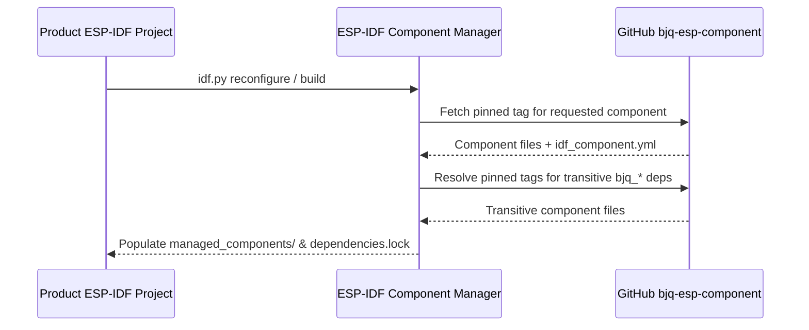

# Consuming Components in ESP-IDF v6.1.0 Projects

All Bojaqu shared components are consumed via the **ESP-IDF Component Manager** over Git (`git:` + `path:` + pinned release tag).

## 1. Declare the Dependency in `main/idf_component.yml`

```yaml
dependencies:
  idf:
    version: ">=6.1.0,<7.0.0"
  bjq_mfrc522:
    git: "https://github.com/blankryan/bjq-esp-component.git"
    path: "drivers/bjq_mfrc522"
    version: "bjq_mfrc522/v0.1.0"
```

## 2. Resolve and Lock Versions

Run:

```bash
idf.py reconfigure
```

Commit the generated `dependencies.lock` file in your product repository so every build records the exact Git commit SHA of every direct and transitive component.

## 3. Transitive Intra-Repo Dependencies

When a higher-layer component (for example under `platform/` or `features/`) depends on a lower-layer component (such as `utilities/` or `drivers/`), its own `idf_component.yml` declares the pinned Git tag. ESP-IDF Component Manager resolves transitive dependencies automatically:



## 4. Temporary Local Override During Co-Development

While iterating simultaneously on a product and a local checkout of `bjq-esp-component`, you may temporarily add `override_path` in your **product's** `idf_component.yml` (never merge `override_path` to product `main`):

```yaml
dependencies:
  bjq_mfrc522:
    override_path: "../../../bjq-esp-component/drivers/bjq_mfrc522"
```
