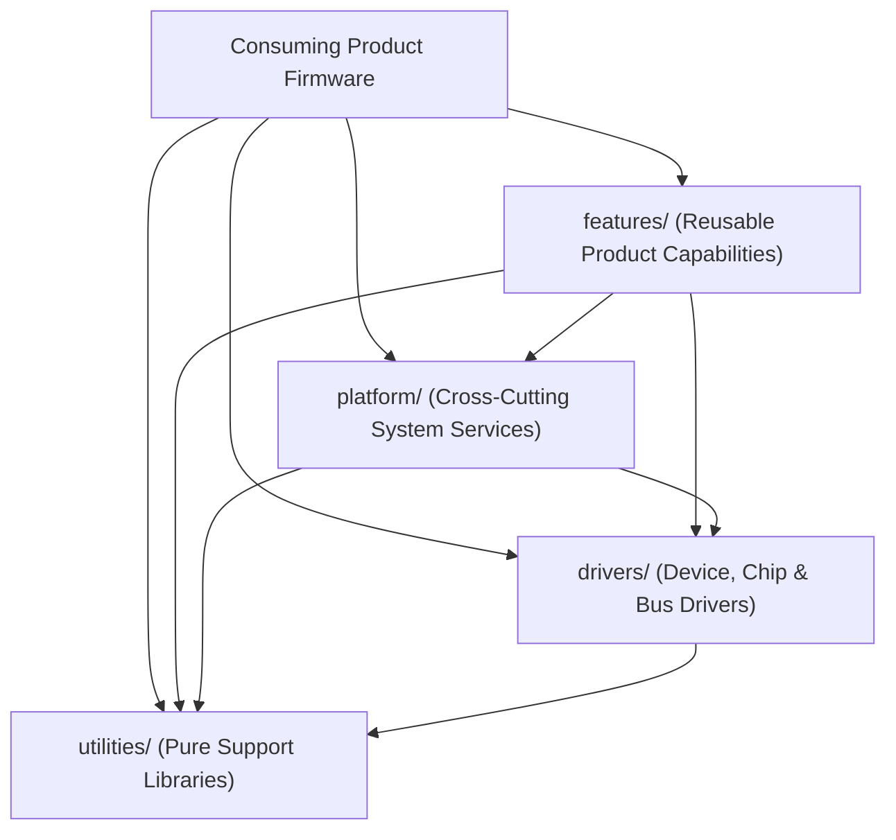

# Bojaqu ESP-IDF v6.1.0 Components

Welcome to the documentation portal for **`bjq-esp-component`** — the shared, Apache-2.0 licensed ESP-IDF v6.1.0 component repository for Bojaqu embedded and IoT products.

## Architectural Layers

Components are organized into four strict layers with one-way downward dependencies:

## Quick Links

- [Component Catalog](components/index.md) — browse all components, versions, and target SoCs
- [Consuming Components](consuming-components.md) — add `bjq_*` components to your ESP-IDF v6.1 project
- [C API Reference (Doxygen)](api-reference.md) — generated public C header documentation
- [Contributing & Releases](contributing-and-releases.md) — scaffold components, run validation, and cut releases
