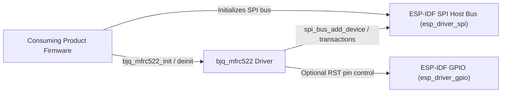

# Architecture — `bjq_mfrc522`

## Current Behavior vs. Design Intent

- **Current behavior:** Implements handle lifecycle (`bjq_mfrc522_init`, `bjq_mfrc522_deinit`, `bjq_mfrc522_get_config`), configuration validation, optional reset GPIO initialization, and SPI device attachment on a caller-owned SPI host bus.
- **Design intent:** Add register read/write primitives, soft reset/version verification, antenna control, and ISO14443A PICC anticollision/UID reading without changing SPI bus ownership semantics.

## Module Overview

## Ownership & Lifecycle

1. The consuming product calls `spi_bus_initialize()` once for the shared SPI host.
2. The product calls `bjq_mfrc522_init()` to attach a dedicated `spi_device_handle_t` and optionally configure `rst_io_num`.
3. `bjq_mfrc522` owns the opaque `bjq_mfrc522_handle_t` and `spi_device_handle_t`, but never frees the SPI host bus.
4. Calling `bjq_mfrc522_deinit()` detaches the SPI device and frees the handle. Callers must not dereference the handle afterward.
