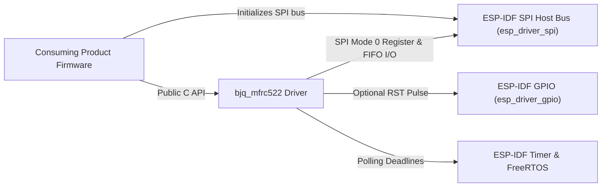
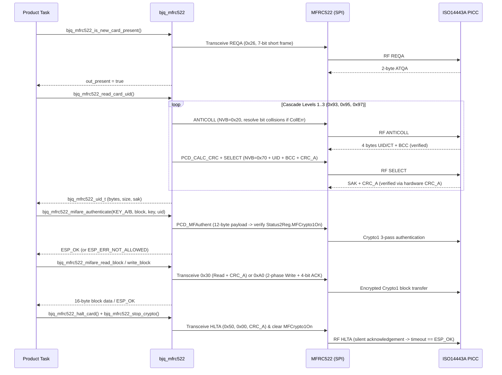

# Architecture — `bjq_mfrc522`

## Current Behavior vs. Design Intent

- **Current behavior:** Implements full SPI register I/O (single and 64-byte FIFO burst transfers), hardware/software reset, `VersionReg` reading, antenna TX1/TX2 & receiver gain control, MFRC522 hardware CRC_A calculation, ISO/IEC 14443-3A card detection (`REQA`/`WUPA`), multi-cascade anticollision/select (4-, 7-, and 10-byte UIDs), `HLTA`, SAK PICC type decoding, UID formatting, and MIFARE Classic Crypto1 sector authentication (`PCD_MFAuthent`) + 16-byte block read/write (safe data-block write and raw trailer write).
- **Design intent:** Optional MIFARE Classic value-block operations and Ultralight/NTAG page read/write helpers in future minor releases, keeping existing APIs backward-compatible.

## Module Overview

## ISO/IEC 14443-3A Card-Reading Sequence

## Ownership & Lifecycle

1. The consuming product calls `spi_bus_initialize()` once for the shared SPI host.
2. The product calls `bjq_mfrc522_init()`, which attaches a dedicated `spi_device_handle_t`, optionally configures `rst_io_num`, runs `bjq_mfrc522_reset()`, applies default `RFCfgReg` gain, and turns on TX1/TX2 antenna drivers.
3. `bjq_mfrc522` owns the opaque `bjq_mfrc522_handle_t` and `spi_device_handle_t`, and never frees the caller-owned SPI host bus.
4. Calling `bjq_mfrc522_deinit()` disables the RF antenna, detaches the SPI device, and frees the handle.
