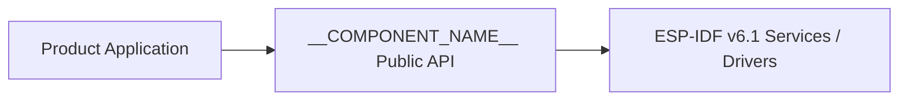

# Architecture — `__COMPONENT_NAME__`

## Current Behavior vs. Design Intent

- **Current behavior:** Minimal lifecycle scaffold (`__COMPONENT_NAME___init` / `__COMPONENT_NAME___deinit`) ready for implementation.
- **Design intent:** Replace this section with the verified module architecture once hardware or protocol logic is implemented.

## Module Overview

## Ownership & Lifecycle

1. Caller allocates `__COMPONENT_NAME___config_t` (stack or static) and calls `__COMPONENT_NAME___init()`.
2. The component allocates an opaque handle and owns all internal state until `__COMPONENT_NAME___deinit()` is called.
3. Callers must not use a handle after `__COMPONENT_NAME___deinit()` returns.
